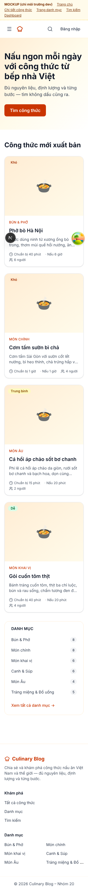
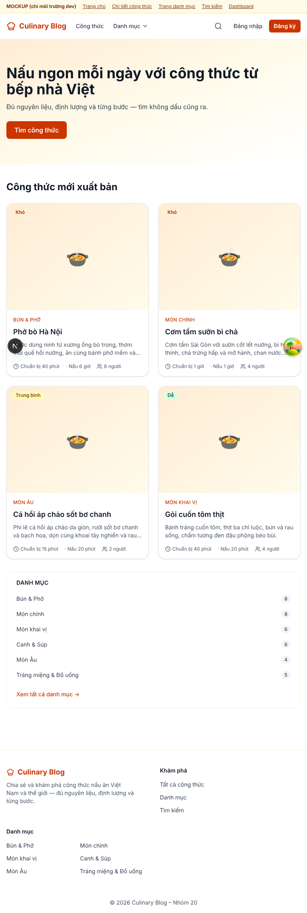
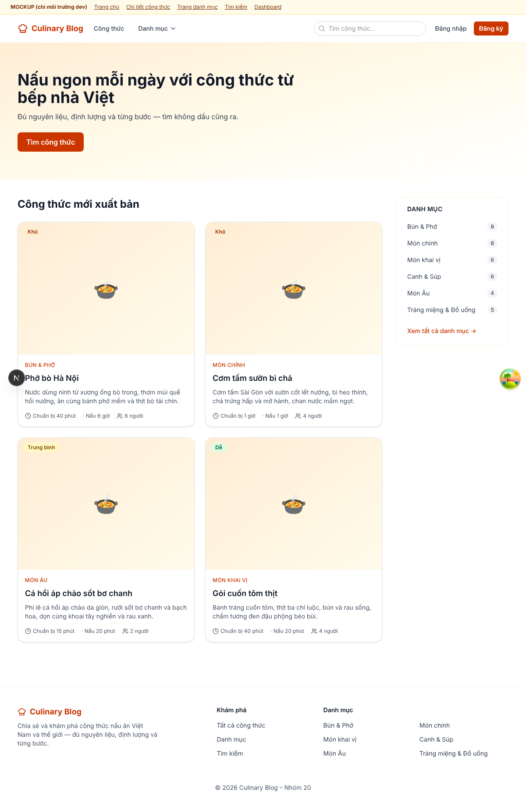
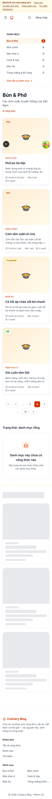
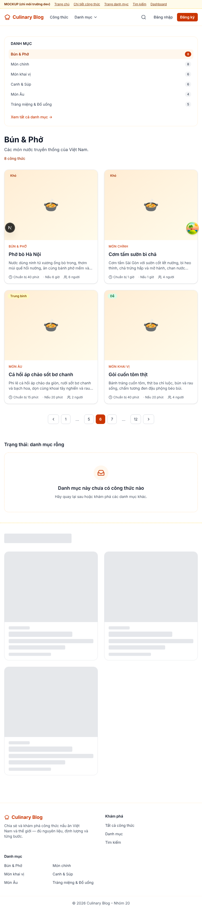
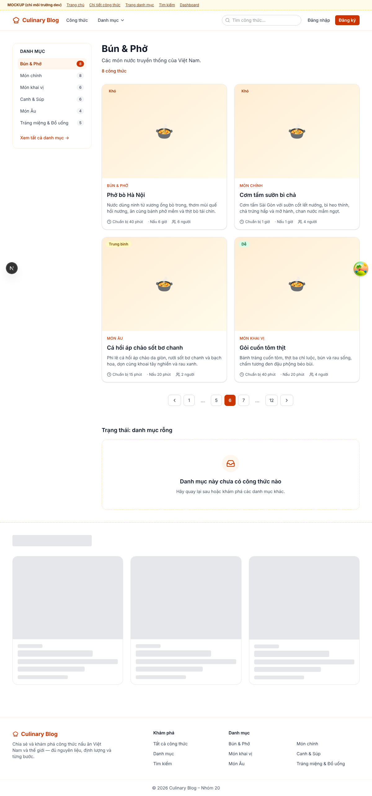

# BÁO CÁO KẾT QUẢ BUỔI 6 — DEV 3

**Dev 3:** Đoàn Hồng Tiến — MSSV 2314291 — Nhóm 20 — Kỹ sư Nội dung (Category / Recipe read / Search)
**Nhánh:** [`2314291_DoanHongTien_buoiso6`](https://github.com/ThangThieng/Phat_trien_ung_dung_web_nang_cao/tree/2314291_DoanHongTien_buoiso6) — tách từ `develop` (`847c7e7`, đã có commit nền Buổi 6 của Dev 4: route group, lớp gọi API `ky`, bộ xử lý lỗi, bố cục ba nhóm trang). **PR vào `develop`.**
**Phạm vi (KE_HOACH_PHAT_TRIEN_8_BUOI.md — Buổi 6, Dev 3):** **Lab 6** — component khung trang, component dùng chung, giao diện tĩnh (mockup) với dữ liệu mẫu thật; kèm **phần API của CR-2026-05 / MT-66** (bộ lọc thời gian cho `GET /recipes/search`).
**Tài liệu bám sát:** `SPEC/SRS_Culinary_Blog_v1.2.3.md` (§5.1, §8.3, FR-SRCH-001, NFR-USE-001/002/004, NFR-PERF-003/005) và `SPEC/SRS_MAU_THUAN_VA_GIAI_PHAP.md` (MT-66, MT-67; §4 D-7).

---

## 1. Tóm tắt công việc

| # | Hạng mục (kế hoạch) | Kết quả |
|---|---|---|
| 1 | Component khung trang `components/layout/`: `Header`, `Footer`, `SidebarCategory`, `UserMenu`, menu điện thoại | ✅ Thay `SiteHeader` (Buổi 2) và `InterimUserMenu` (bản tạm của Dev 4). ⚠️ Chưa dùng `DropdownMenu`/`Sheet`/`Badge` của shadcn — commit nền shadcn của Dev 2 chưa vào `develop` |
| 2 | Component dùng chung `components/shared/`: `Pagination`, `LoadingSkeleton`, `EmptyState`, `ErrorBoundary`, `ErrorFallback`; `error.tsx` / `global-error.tsx` / `not-found.tsx` | ✅ Thay `RecipeGridSkeleton`, `InterimPageLoading`, `InterimErrorFallback` |
| 3 | Giao diện tĩnh: fixtures từ seed + `app/(dev)/mockups/{home,recipe,category,search,dashboard}`; 404 ở production; rà 320 / 768 / 1200 px | ✅ Đo bằng Playwright: 0 px cuộn ngang ở cả 15 trường hợp; ảnh chụp ở mục 5 |
| 4 | CR-2026-05 / MT-66: `maxCookTime`, `maxPrepTime`, `minServings` cho `GET /recipes/search` + kiểu Frontend | ✅ Dùng chung `RecipeFilterSpec`; unit test + integration test |
| 5 | Kiểm thử: `Pagination.test.tsx`, `ErrorBoundary.test.tsx`, `SidebarCategory.test.tsx` | ✅ Kèm thêm `UserMenu.test.tsx` |

## 2. Frontend — component

| Thành phần | File | Ghi chú |
|---|---|---|
| `PublicShell` | `components/layout/PublicShell.tsx` | Server Component `async`: lấy danh mục **một lần** (`getCategories()`, Data Cache `revalidate: 1800`) rồi truyền cho `Header` và `Footer`; API lỗi → mảng rỗng, khung trang không hỏng |
| `Header` | `components/layout/Header.tsx` | Server Component; chỉ các mảnh tương tác là Client Component nhỏ: `NavLink` (`aria-current`), `CategoryNav` (nhận `initialCategories`), `SearchBar`, `HeaderActions`, `MobileNav` |
| `UserMenu` | `components/layout/UserMenu.tsx` | Khách: Đăng nhập / Đăng ký. Đã đăng nhập: Hồ sơ, Dashboard; Admin thêm Quản lý danh mục, Người dùng, Thư viện ảnh; Đăng xuất. Mẫu WAI-ARIA *menu button*: mũi tên/Home/End, Escape trả focus về nút, bấm ra ngoài / Tab / đổi trang đều đóng. Dùng cả ở header công khai và thanh trên của dashboard |
| `MobileNav` | `components/layout/MobileNav.tsx` | Dưới 768 px: nút ☰ mở ngăn phủ (portal vào `document.body`) có ô tìm kiếm (form GET), link trang, danh mục; Escape / đổi trang đóng, khóa cuộn nền |
| `Footer` | `components/layout/Footer.tsx` | Server, landmark `<footer>`, liên kết khám phá, 8 danh mục đầu, bản quyền |
| `SidebarCategory` | `components/layout/SidebarCategory.tsx` | Server, không JavaScript; `<nav aria-label="Danh mục">`, số công thức dạng huy hiệu + chữ ẩn cho trình đọc màn hình, mục đang xem `aria-current="page"`. Buổi 7 gắn vào trang chủ / trang danh mục |
| `Pagination` | `components/shared/Pagination.tsx` | `<nav aria-label="Phân trang">`, dấu `…`, **luôn 7 ô** từ 8 trang trở lên (không đổi bề rộng — CLS), link thật qua `buildHref` (giữ bộ lọc, chạy không cần JS), nhận `hasPreviousPage` / `hasNextPage` của `PagedResult` |
| `LoadingSkeleton` | `components/shared/LoadingSkeleton.tsx` | 4 biến thể `recipe-grid`, `recipe-detail`, `table`, `form`; kích thước bằng nội dung thật (ảnh 4:3 như `RecipeCard`, khung thẻ như `AuthCard`); `role="status"` + `aria-busy` |
| `EmptyState` | `components/shared/EmptyState.tsx` | Biểu tượng, tiêu đề (cấp `h1`/`h2`/`h3` theo ngữ cảnh), mô tả, khe hành động. Dùng ở `/recipes`, `/search`, `/categories`, `/categories/[slug]`, trang 404 |
| `ErrorBoundary` | `components/shared/ErrorBoundary.tsx` | Class component (React chỉ cho class bắt lỗi render) + `QueryErrorResetBoundary`: "Thử lại" vừa reset boundary vừa refetch truy vấn lỗi |
| `ErrorFallback` | `components/shared/ErrorFallback.tsx` | Câu thân thiện qua `normalizeError` (Dev 4), **mã tra cứu** (`correlationId` hoặc `digest`), nút thử lại; không lộ stack trace |

## 3. Giao diện tĩnh (mockup)

- `src/mocks/fixtures/categories.ts` (6 danh mục) và `recipes.ts` (4 công thức) sinh **nguyên văn** từ `Infrastructure/Persistence/Seed/Data/*.json`; khai báo `satisfies Category[]` / `satisfies RecipeDetail[]` → đổi kiểu mà quên dữ liệu mẫu là lỗi biên dịch. Chọn đúng các ca khó: tên dài nhất ("Cá hồi áp chảo sốt bơ chanh"), nhiều nguyên liệu nhất ("Cơm tấm sườn bì chả" — 14 nguyên liệu), định lượng dạng chữ ("vừa đủ").
- Tác giả, ngày đăng trong fixtures là giá trị cố định (seed sinh ngẫu nhiên bằng Bogus, JSON không có).
- Route `app/(dev)/mockups/{home,recipe,category,search,dashboard}`; mỗi trang có phần "trạng thái" (rỗng, lỗi, đang tải).
- **Chặn ở production ở cả layout lẫn từng trang** (`mockups/dev-only.ts`): chỉ chặn ở layout thì `next build && next start` vẫn trả 404 nhưng payload RSC chứa nguyên dữ liệu mockup (đã đo — layout và page render song song). Sau khi sửa: 6/6 URL `/mockups/**` → 404, HTML không còn dữ liệu mẫu.

## 4. Backend — CR-2026-05 / MT-66

- `SearchRecipesQuery` thêm `MaxCookTime`, `MaxPrepTime`, `MinServings` → `Filter` dùng chung `RecipeFilterSpec` với `GET /recipes` (repository đã áp dụng sẵn từ Buổi 4, không viết bộ lọc thứ hai). Không thêm tham số sắp xếp — kết quả vẫn theo `ts_rank`.
- `SearchRecipesQueryValidator`: phút ≥ 0, khẩu phần ≥ 1 qua `RecipeQueryRules` dùng chung với `GetRecipesQueryValidator`.
- `RecipeQueryEndpoints.SearchRecipesAsync` nhận thêm 3 tham số tùy chọn — tương thích ngược.
- Khóa cache `search:{queryHash}` đã chứa 3 bộ lọc qua `RecipeFilterSpec.ToCacheSegment()`.
- Frontend: `RecipeSearchParams` thêm 3 trường; `searchRecipes()` truyền tiếp tự động; `search-contract.test.ts` so `RecipeSearchParams` với tham số của `record SearchRecipesQuery`.

## 5. Ảnh chụp bố cục (mockup, `next dev`)

| | 320 px | 768 px | 1200 px |
|---|---|---|---|
| Trang chủ |  |  |  |
| Trang danh mục |  |  |  |

Đủ 16 ảnh (5 trang × 3 kích thước + menu điện thoại mở) trong `docs/lab06-dev3/`.

## 6. Điểm lệch so với kế hoạch

| # | Kế hoạch ghi | Thực tế | Lý do |
|---|---|---|---|
| 1 | `DropdownMenu`, `Sheet`, `Badge` của shadcn/ui | Tailwind + ARIA trong component | Commit nền shadcn của Dev 2 chưa vào `develop`; khi có, thay phần khung mà không đổi nơi dùng |
| 2 | Tách `RecipeFilterRules` dùng chung cho hai validator | Dùng lại `RecipeQueryRules` (có từ Buổi 4) | Đã chứa đúng các quy tắc cần dùng chung; unit test khẳng định hai validator cho cùng kết quả |
| 3 | Endpoint nhận tham số qua `[AsParameters]` | Tham số mặc định trên handler | Giống cách `GET /recipes` khai báo cùng bộ lọc |
| 4 | Integration test `q=pho&maxCookTime=30` | `q=ha+noi&maxCookTime=60` | Dữ liệu integration test: Phở nấu 180 phút → ca của kế hoạch luôn rỗng, không chứng minh được bộ lọc |
| 5 | (không nêu) | Ô tìm kiếm header hiện từ 1024 px; "Đăng ký" ẩn dưới 640 px | Ảnh chụp 768 px cho thấy chữ header xuống dòng |
| 6 | `getCategories` (D-7 thuộc Buổi 7) | Đổi `revalidate` 3600 → 1800 ngay | Kế hoạch Buổi 6 ghi header lấy danh mục với `revalidate: 1800`; header/footer dùng hàm này |

## 7. Test và kiểm chứng đã chạy (17–18/10/2026)

| Lệnh / kiểm tra | Kết quả |
|---|---|
| `dotnet build` + `dotnet test` toàn solution trên máy dev (Docker, Testcontainers) | ✅ Build succeeded; **418/418** test đạt. Hai lỗi analyzer lộ ra lúc build đã sửa: SA1512 (dòng trống sau comment), S4144 (test trùng thân → gộp 3 ca vào `Search_InvalidQuery_Returns400`) |
| Frontend `npm run lint` / `tsc --noEmit` | ✅ 0 lỗi / 0 lỗi |
| Frontend `jest` | ✅ **251/251** (27 bộ) |
| `next build` | ✅ First Load JS lớn nhất `/dashboard/categories` 188 kB ≤ 200 kB; `/` 106 kB |
| `next start` (production) | ✅ `/`, `/recipes`, `/categories`, `/search`, `/auth/*`, `/dashboard/categories` → 200; `/mockups/*` và URL lạ → 404 |
| Playwright: 5 mockup × 320 / 768 / 1200 px | ✅ 0 px cuộn ngang; menu điện thoại mở không làm trang cuộn, Escape đóng |

### 7.1 Môi trường kiểm chứng

- `next build` trong môi trường đo của tôi không tải được Google Fonts (`Inter`): build ở **bản sao** thư mục tạm, thay font bằng giá trị rỗng; code trong repo không đổi. Image Docker `frontend` build thành công trên máy dev (`docker compose up -d --build api frontend nginx`).
- Giao diện đã chạy trên stack Docker của máy dev (header mới, menu tài khoản Admin, trang `/recipes`); danh sách kiểm tra tay đầy đủ ở hướng dẫn kiểm thử Buổi 6.

## 8. Danh sách file thay đổi

**Backend (sửa):** `API/Endpoints/RecipeQueryEndpoints.cs`, `Application/Features/Recipes/SearchRecipesQuery.cs`, `tests/…/Content/RecipeQueryEndpointsTests.cs`, `tests/…/Application.UnitTests/RecipeQueryTests.cs`.
**Frontend (mới):** `components/layout/{Header,Footer,HeaderActions,MobileNav,NavLink,SidebarCategory,UserMenu}.tsx`, `components/shared/{EmptyState,ErrorBoundary,ErrorFallback,LoadingSkeleton}.tsx`, test `{Pagination,ErrorBoundary,SidebarCategory,UserMenu}.test.tsx`, `app/global-error.tsx`, `app/(dev)/**`, `mocks/fixtures/{categories,recipes}.ts`.
**Frontend (sửa):** `components/layout/{PublicShell,DashboardShell,interim-shell}.tsx`, `components/shared/Pagination.tsx`, `app/(auth|dashboard|public)/error.tsx`, `loading.tsx` của `(auth)`, `(dashboard)`, `recipes/(list)`, `categories/(list)`, `app/not-found.tsx`, trang `/recipes`, `/search`, `/categories`, `/categories/[slug]`, `features/categories/{api.ts,components/CategoryNav.tsx}`, `types/search.ts`, `types/__tests__/search-contract.test.ts`.
**Frontend (xóa):** `components/layout/SiteHeader.tsx`, `components/shared/RecipeGridSkeleton.tsx` (đã được thay thế).
**Tài liệu:** `docs/lab06-dev3/*.png`, báo cáo này (`.md` + `.docx`).

## 9. Commit trên nhánh `2314291_DoanHongTien_buoiso6`

1. [`e249ebf`](https://github.com/ThangThieng/Phat_trien_ung_dung_web_nang_cao/commit/e249ebf) — `feat(ui-shell,search): shared layout and accessible pagination, skeleton, empty state and error boundary with typed static mockups; search time filters (CR-2026-05 MT-66)`
