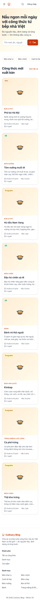
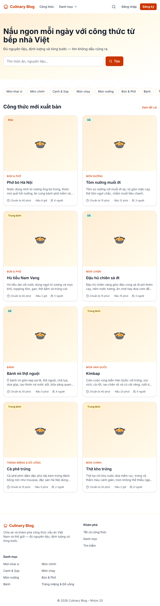
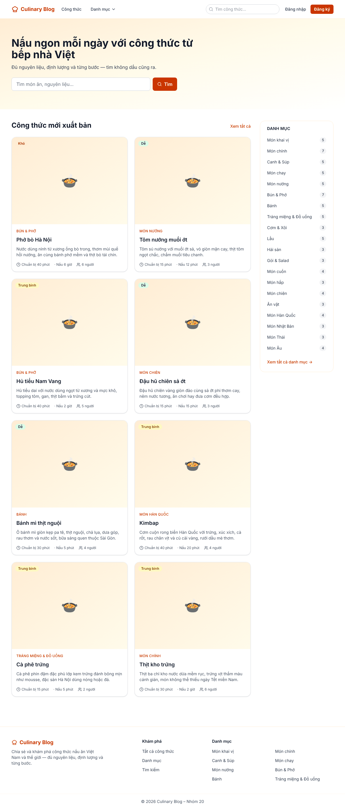
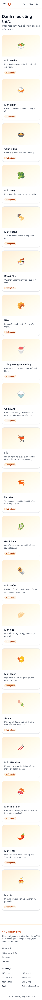
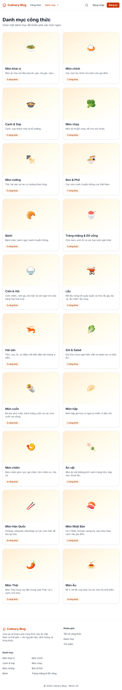
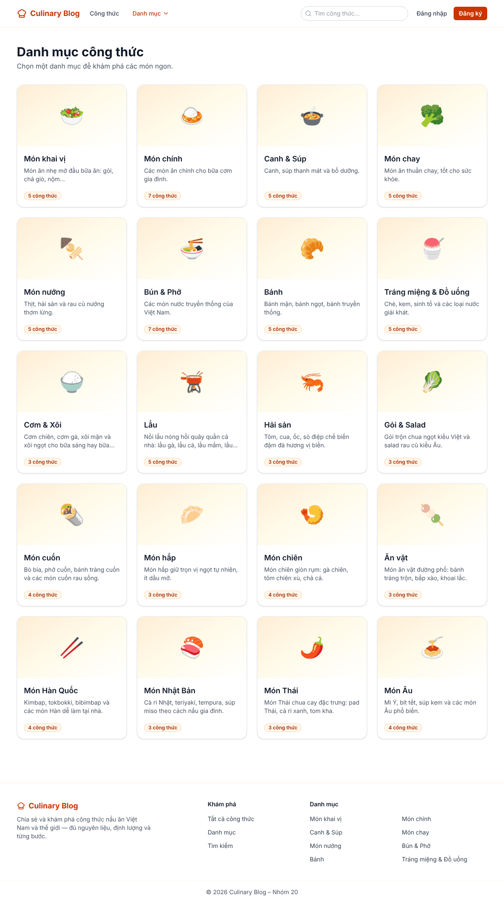
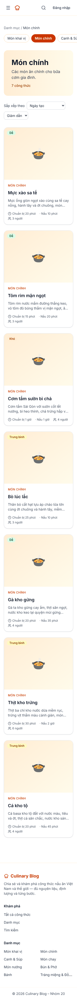
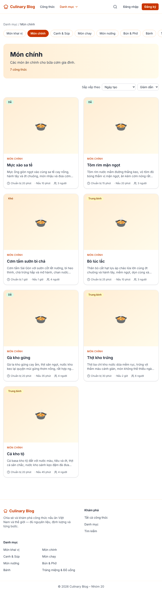
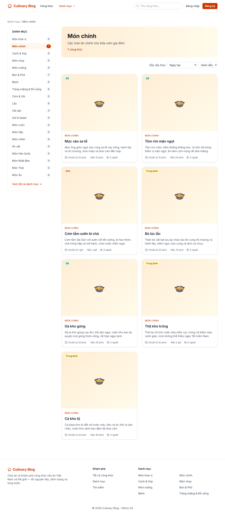

# BÁO CÁO KẾT QUẢ BUỔI 7 — DEV 3

**Dev 3:** Đoàn Hồng Tiến — MSSV 2314291 — Nhóm 20 — Kỹ sư Nội dung (Category / Recipe read / Search)
**Nhánh:** [`2314291_DoanHongTien_buoiso7`](https://github.com/ThangThieng/Phat_trien_ung_dung_web_nang_cao/tree/2314291_DoanHongTien_buoiso7) — tách từ `develop` (`adae8aa`, đã merge Buổi 6 của Dev 1 và Dev 3). **PR vào `develop`.**
**Phạm vi (KE_HOACH_PHAT_TRIEN_8_BUOI.md — Buổi 7, Dev 3):** **Lab 7** — trang chủ `/` (SRS §5.1, MT-23), `FR-CAT-001` `/categories`, `FR-CAT-002` `/categories/[slug]` (nâng cấp trang Buổi 2), **phần còn lại của retrofit D-7** (MT-33.3), `NFR-PERF-003` (`revalidate` ≤ TTL).
**Tài liệu bám sát:** `SPEC/SRS_Culinary_Blog_v1.2.3.md` (§5.1, §5.2, §8.2, §8.3, FR-CAT-001/002, NFR-PERF-003/005, NFR-USE-001/002) và `SPEC/SRS_MAU_THUAN_VA_GIAI_PHAP.md` (MT-23, MT-33.3, MT-57, MT-67; §4 D-7; §5 X-3; §6 O-7, O-8).

---

## 1. Tóm tắt công việc

| # | Hạng mục (kế hoạch) | Kết quả |
|---|---|---|
| 1 | `(public)/page.tsx` — trang chủ: `Promise.all` công thức mới xuất bản (120 s) + danh mục (1800 s); khối giới thiệu có form GET tới `/search`; lưới 8 `RecipeCard`, "Xem tất cả"; `SidebarCategory` ≥ 1200 px, hàng nhãn cuộn ngang dưới 1200 px; ảnh thẻ đầu `priority` | ✅ |
| 2 | `/categories` — retrofit D-7 `revalidate` 3600 → **1800**; lưới `CategoryCard` (ảnh, tên, mô tả hai dòng, huy hiệu số công thức Published); `EmptyState` | ✅ (D-7 đổi số từ Buổi 6). ⚠️ Chưa dùng `Card`/`Badge` của shadcn — commit nền shadcn của Dev 2 chưa vào `develop` |
| 3 | `/categories/[slug]` — phần đầu (tên, mô tả, số công thức), sidebar `activeSlug`, `SortSelect`, `Pagination` giữ tham số sắp xếp, 404 → `notFound()`, danh mục rỗng → `EmptyState` | ✅ Thêm trạng thái "vượt quá trang cuối" khác với "danh mục rỗng" |
| 4 | Kiểm chứng D-7 tự động: `features/categories/api.test.ts` (1800 / 120), `features/recipes/api.test.ts` (120 / 300), lệnh `grep` rỗng | ✅ Thêm `lib/revalidate-ttl.test.ts` chạy lệnh `grep` đó trong `npm test` |
| 5 | Kiểm tra bố cục 320 / 768 / 1200 px trên dữ liệu thật, so với mockup Buổi 6, ảnh chụp vào báo cáo | ✅ 11 ảnh ở `docs/lab07-dev3/` (mục 5); 0 px cuộn ngang, 0 vi phạm CSP, axe 0 vi phạm |
| — | **Phát sinh khi kiểm chứng:** Data Cache không giữ dữ liệu vì `X-Correlation-ID` nằm trong khóa cache (bổ sung MT-67) | ✅ Đã sửa và đo lại: 55 → 3 lượt gọi API cho 15 lượt xem (mục 3) |

## 2. Mâu thuẫn & giải pháp đã áp dụng (Dev 3 — Buổi 7)

| Mục | Mâu thuẫn (tóm tắt) | Giải pháp đã chốt | Áp dụng trong code Buổi 7 | Bằng chứng |
|---|---|---|---|---|
| **MT-23** | Trang chủ hứa "recipe nổi bật" nhưng không có cột/API nào | "Nổi bật" = **mới xuất bản nhất**, `GET /recipes?sortBy=publishedAt&sortOrder=desc&pageSize=8` | `getLatestRecipes()` — không thêm cột, không thêm endpoint; tiêu đề khối là "Công thức mới xuất bản" | `features/recipes/api.test.ts` khẳng định đúng 3 tham số |
| **MT-33.3 / D-7** · **X-3** | `revalidate` 3600 (`/categories`) và 600 (`/categories/[slug]`) dài hơn TTL API; lộ trình ghi "ISR 3600s" | Theo SRS: **1800** và **120** (≤ TTL `categories:all` 30′, `categories:detail` 2′) | `getCategories()` 1800, `getCategoryBySlug()` 120, `getLatestRecipes()` 120 | `features/categories/api.test.ts`, `lib/revalidate-ttl.test.ts` (không còn 3600/600, mọi `revalidate` ≤ 1800) |
| **MT-57** | `/categories/[slug]` ghi ISR nhưng đọc `?page=` nên bắt buộc render động | **SSR + Data Cache** `revalidate: 120` | Trang render theo request; dữ liệu lấy từ Data Cache | Đo: 1 lượt gọi API trong 120 s, gọi lại đúng 1 lần sau khi hết hạn (mục 3) |
| **MT-67** | CSP nonce (NFR-SEC-005) và ISR loại trừ nhau | Ba trang **SSR + Data Cache** cùng `revalidate`; không `export const revalidate` | Không trang nào khai báo `export const revalidate`; giá trị đặt trên từng `fetch`; 0 vi phạm CSP khi chạy production | `revalidate-ttl.test.ts`; Playwright đếm vi phạm CSP = 0 |
| **MT-67 — bổ sung (mới)** | Thực nghiệm MT-67 dùng `fetch` trần; app thật gắn `X-Correlation-ID` mới cho mỗi request → khóa cache khác nhau → Data Cache **không bao giờ trúng** | Request phía server có `next.revalidate > 0` **không** gắn `X-Correlation-ID`; Backend tự sinh mã khi thiếu (SRS §5.2) — không lệch SRS, không cần CR | `lib/api-client.ts` (`usesDataCache` → bỏ qua hook gắn header) | `api-client.server.test.ts`; đo đối chứng 55 → 3 lượt gọi (mục 3). Ghi vào hồ sơ mâu thuẫn: MT-67 phần bổ sung + đánh đổi **O-8** |

**Vì sao điểm mới không thành MT-69:** SRS không sai — §5.2 đã quy định Backend *"sinh tự động nếu không có trong request"*. Chỗ lệch nằm giữa kế hoạch Buổi 6 ("mọi request có `X-Correlation-ID`") và quy tắc vàng §2.3. Vì vậy mục này được ghi thành **phần bổ sung của MT-67** và **đánh đổi O-8**, còn kế hoạch ghi chú ngoại lệ ở §2.2 và kiểm chứng Buổi 6. Không mở Change Request.

## 3. Đo Data Cache trên bản production

Môi trường: `next build && next start` (Next.js 15.5.25), API giả đếm lượt gọi theo đường dẫn (mục 7.1).

**3.1. Đối chứng — có và không có bản sửa `X-Correlation-ID`** (15 lượt xem: 5 × `/`, 5 × `/categories`, 5 × `/categories/mon-chinh`):

| Bản build | `GET /categories` | `GET /recipes?…` | `GET /categories/mon-chinh?…` | Tổng | Request mang `X-Correlation-ID` |
|---|---|---|---|---|---|
| Lớp gọi API Buổi 6 (gắn header cho mọi request) | 45 | 5 | 5 | **55** | 55 |
| Code Buổi 7 | 1 | 1 | 1 | **3** | 0 |

Header mới mỗi lần không chỉ làm Data Cache trượt mà còn làm mất cơ chế gộp lời gọi trùng trong cùng một lần render (3 lượt `/categories` mỗi lượt xem). Đây đúng là tình huống quy tắc vàng §2.3 muốn tránh: API bị gọi ở mọi lượt xem dù `revalidate` đã đặt đúng.

**3.2. Hết hạn đúng TTL của từng nguồn dữ liệu** (bản Buổi 7, xóa `fetch-cache` trước khi đo):

| Bước | Lượt gọi tích lũy `/categories` · `/recipes` · `/categories/mon-chinh` |
|---|---|
| `GET /` lần đầu | 1 · 1 · 0 |
| +3 × `/`, 1 × `/categories`, 1 × `/categories/mon-chinh`, rồi 9 lượt xem nữa | 1 · 1 · 1 |
| +125 s, `GET /` (dữ liệu cũ trả ngay, làm mới nền) | 1 · **2** · 1 |
| `GET /categories/mon-chinh` × 2 | 1 · 2 · **2** |
| `GET /categories` | **1** · 2 · 2 — danh mục (1800 s) không bị gọi lại |

Đo thêm: (a) danh mục cùng tag `categories` với trang danh mục (120 s) vẫn không bị gọi lại khi trang danh mục hết hạn; (b) `export const dynamic = 'force-dynamic'` không vô hiệu `next.revalidate` của từng `fetch`. Trong một lần đo, `/categories` có thêm 1 lượt gọi. Đã truy ra nguyên nhân: lệnh `next build` chạy song song dựng sẵn trang `/_not-found` và gọi `GET /categories` lúc build (chạy lại `next build` thấy đúng +1). Nghĩa là không phải lỗi cache lúc chạy.

## 4. Frontend — chi tiết theo trang

| Trang / thành phần | File | Ghi chú |
|---|---|---|
| Trang chủ `/` | `app/(public)/page.tsx` | `Promise.all([getLatestRecipes(), getCategories().catch(() => [])])` — danh mục lỗi chỉ mất sidebar, trang vẫn hiện công thức. Form GET `role="search"`, `minLength` = 2 (ngưỡng 400 của API). Lưới 1 / 2 / 3 cột; thẻ đầu `priority` (LCP). `metadata` có `canonical` |
| `/categories` | `app/(public)/categories/(list)/page.tsx` | Danh sách dạng `<ul>`/`<li>`; `CategoryCard` cao bằng nhau trong hàng; `EmptyState` khi chưa có danh mục |
| `CategoryCard` | `features/categories/components/CategoryCard.tsx` | Ảnh trang trí `alt=""` (tên đã ở tiêu đề), mô tả `line-clamp-2`, huy hiệu "N công thức" (Backend chỉ đếm Published). **Biểu tượng thay ảnh đủ 20/20 danh mục mẫu** (trước chỉ 8 danh mục của Buổi 2) |
| `/categories/[slug]` | `app/(public)/categories/[slug]/page.tsx` | `cache()` của React cho `generateMetadata` và trang dùng chung một lời gọi API. Breadcrumb, phần đầu, `SortSelect` (chỉ `sortBy`/`sortOrder` — §8.2 không có bộ lọc), `Pagination` với `buildHref` giữ sắp xếp, `notFound()` khi 404, hai trạng thái rỗng khác nhau ("danh mục chưa có công thức" / "trang vượt quá trang cuối" kèm nút về trang đầu) |
| `SidebarCategory` | `components/layout/SidebarCategory.tsx` | **Landmark `<aside>`** bọc `<nav aria-label="Danh mục">` (NFR-USE-002 liệt kê `<aside>`); `aria-current="page"` cho mục đang xem; lớp ẩn/hiện theo 1200 px đặt trên `<aside>` |
| `CategoryChips` | `components/layout/CategoryChips.tsx` | Hàng nhãn cuộn ngang dưới 1200 px, cuộn nằm trong `<ul>` (không làm trang cuộn ngang); chữ ẩn "N công thức" cho trình đọc màn hình |
| Lớp gọi API | `lib/api-client.ts` | Request phía server có `next.revalidate > 0` không gắn `X-Correlation-ID` (mục 2, 3) |

## 5. Ảnh chụp bố cục (bản production, dữ liệu seed CR-2026-03)

| | 320 px | 768 px | 1200 px |
|---|---|---|---|
| Trang chủ |  |  |  |
| `/categories` |  |  |  |
| `/categories/mon-chinh` |  |  |  |

Trạng thái: [trang vượt quá trang cuối](../docs/lab07-dev3/category-past-last-page-768.png) (`?page=5` → 200, `EmptyState` "Trang này không có công thức nào" + "Về trang đầu") · [danh mục không tồn tại](../docs/lab07-dev3/category-404-768.png) (HTTP **404**, `<title>` "Không tìm thấy danh mục").

**So với mockup Buổi 6 (`docs/lab06-dev3/`):**
- Bố cục giữ nguyên: cột phụ danh mục ≥ 1200 px, lưới 1 / 2 cột ở 320 / 768 px.
- Khác mockup:
  - dưới 1200 px, cột phụ đổi thành hàng nhãn cuộn ngang (mockup dùng `lg` = 1024 px; kế hoạch Buổi 7 chốt 1200 px — breakpoint "desktop" của NFR-USE-001);
  - thẻ hiện biểu tượng thay ảnh vì seed không có ảnh (giống CSDL dev).

**Đo tự động (Playwright, 3 trang × 3 kích thước):**

| Kiểm tra | 320 px | 768 px | 1200 px |
|---|---|---|---|
| Cuộn ngang (`scrollWidth − innerWidth`) | 0 | 0 | 0 |
| Sidebar `<aside>` hiện / hàng nhãn hiện | ẩn / hiện | ẩn / hiện | hiện / ẩn |
| `aria-current="page"` ở `/categories/mon-chinh` | 1 (nhãn) | 1 (nhãn) | 1 (sidebar) |
| Vi phạm CSP (console) | 0 | 0 | 0 |
| axe-core, thẻ WCAG 2.1 A/AA | 0 vi phạm | — | 0 vi phạm |

## 6. Điểm lệch so với kế hoạch

| # | Kế hoạch ghi | Thực tế | Lý do |
|---|---|---|---|
| 1 | `CategoryCard` chuyển sang shadcn `Card` + `Badge` | Tailwind cùng dáng (huy hiệu là ``) | Commit nền shadcn của Dev 2 (Buổi 6) chưa vào `develop` — `components/ui/` trống. Khi có, thay đúng phần khung, chỗ dùng không đổi |
| 2 | (không nêu) | Bỏ `X-Correlation-ID` ở request phía server dùng Data Cache | Không bỏ thì D-7 / MT-67 chỉ đúng trên giấy: API bị gọi ở mọi lượt xem (đo 55 lượt / 15 lượt xem). Ghi vào hồ sơ mâu thuẫn (MT-67 bổ sung, O-8) và kế hoạch (§2.2, kiểm chứng Buổi 6) |
| 3 | Kiểm tay `grep -rn "revalidate: \(3600\|600\)" frontend/src` | Thành kiểm thử `lib/revalidate-ttl.test.ts` | Lệnh `grep` chỉ chạy khi có người nhớ chạy — đúng nguyên nhân sinh ra D-7. Chạy thủ công, lệnh `grep` chỉ khớp chính file kiểm thử này |
| 4 | (không nêu) | `SidebarCategory` là `<aside>` bọc `<nav>` | NFR-USE-002 liệt kê `<aside>`; cột phụ cần là landmark "nội dung bổ trợ" |
| 5 | (không nêu) | Biểu tượng cho 12 danh mục mới của CR-2026-03 | Ảnh chụp trên dữ liệu thật cho thấy 12/20 danh mục cùng hiện 🍽️ |
| 6 | `export const dynamic` không nhắc | Giữ `force-dynamic` ở ba trang | `next build` của image Docker chạy khi chưa có API; đo xác nhận `revalidate` trên `fetch` vẫn được tôn trọng |

## 7. Test và kiểm chứng đã chạy (21/10 và 26/10/2026)

| Lệnh / kiểm tra | Kết quả |
|---|---|
| Frontend `npm run lint` / `tsc --noEmit` | ✅ 0 lỗi / 0 lỗi |
| Frontend `jest` | ✅ **309/309** (40 bộ) |
| `next build` | ✅ First Load JS: `/` 112 kB, `/categories` 112 kB, `/categories/[slug]` 113 kB; lớn nhất `/dashboard/categories` 189 kB ≤ 200 kB |
| `next start` + curl | ✅ `/`, `/categories`, `/categories/mon-chinh`, `?page=2&sortBy=title&sortOrder=asc` → 200; `/categories/khong-ton-tai` → **404** |
| Data Cache (mục 3) | ✅ 3 lượt gọi API / 15 lượt xem; hết hạn đúng 120 s / 1800 s |
| Playwright 3 trang × 320 / 768 / 1200 px + axe | ✅ 0 px cuộn ngang, 0 vi phạm CSP, 0 vi phạm axe |
| Backend | Buổi 7 của Dev 3 không đổi Backend; `dotnet build && dotnet test` cần chạy trên máy có .NET 10 + Docker trước khi mở PR (DoD) |

### 7.1 Môi trường kiểm chứng

- Máy đo không có .NET 10 SDK và không kéo được image Docker. Vì vậy Backend không chạy được ở đây.
- Frontend chạy bản production thật (`next build && next start`) và gọi một **API giả** trả đúng hợp đồng SRS §8.2/§8.3 (`Category`, `CategoryDetail`, `PagedResult<RecipeSummary>`, 404/400 dạng Problem Details).
- Dữ liệu của API giả là **nguyên văn** catalog seed `Seed/Data/*.json`: 20 danh mục, 100 công thức, khoảng 85% Published như `DatabaseSeeder`.
- Số lượng theo danh mục có thể lệch nhẹ với CSDL của từng máy, vì `DatabaseSeeder` chọn ngẫu nhiên công thức nào là Draft.
- `next build` không tải được Google Fonts (`Inter`). Bản đo build ở **bản sao** thư mục, thay bằng font Inter tự host (`@fontsource-variable/inter`, cùng họ chữ); code trong repo không đổi.
- Nên chụp lại 3 trang trên stack Docker của máy dev (`docker compose up -d --build`) khi demo.

## 8. Danh sách file thay đổi

**Commit `16e9f93` (21/10):** `app/(public)/page.tsx`, `app/(public)/categories/(list)/page.tsx`, `app/(public)/categories/[slug]/page.tsx` (+ 3 file test), `components/layout/CategoryChips.tsx` (+ test), `features/categories/components/CategoryCard.tsx` (+ test), `features/categories/api.test.ts`, `features/recipes/api.ts` (`getLatestRecipes`), `features/recipes/api.test.ts`, `features/recipes/components/RecipeCard.tsx` (`priority`), `lib/api-client.ts`, `lib/api-client.server.test.ts`, `lib/revalidate-ttl.test.ts`.
**Commit `5469e1e` (26/10):** `components/layout/SidebarCategory.tsx` (+ test), `features/categories/components/CategoryCard.tsx` (+ test), `app/(public)/page.test.tsx`.
**Tài liệu:** `docs/lab07-dev3/*.png` (11 ảnh); `SPEC/SRS_MAU_THUAN_VA_GIAI_PHAP.md` (D-7 ✅, hiện thực MT-23, MT-57, bổ sung MT-67, đánh đổi O-8); `SPEC/KE_HOACH_PHAT_TRIEN_8_BUOI.md` (ghi chú thực hiện Buổi 6 và Buổi 7 của Dev 3, ngoại lệ `X-Correlation-ID` ở §2.2 và kiểm chứng Buổi 6, D-7 ✅ ở §4.1); báo cáo này (`.md` + `.docx`).

## 9. Commit trên nhánh `2314291_DoanHongTien_buoiso7`

1. [`16e9f93`](https://github.com/ThangThieng/Phat_trien_ung_dung_web_nang_cao/commit/16e9f93) — `feat(home,categories): homepage with latest recipes and category sidebar, category list and detail pages with fetch revalidate aligned to api ttl (D-7)`
2. [`5469e1e`](https://github.com/ThangThieng/Phat_trien_ung_dung_web_nang_cao/commit/5469e1e) — `refactor(categories): aside landmark for category sidebar and fallback icons for all 20 seed categories`
3. Commit tài liệu — `docs(lab07): dev 3 session 7 report, layout screenshots, data cache measurements; record MT-67 addendum and O-8`
