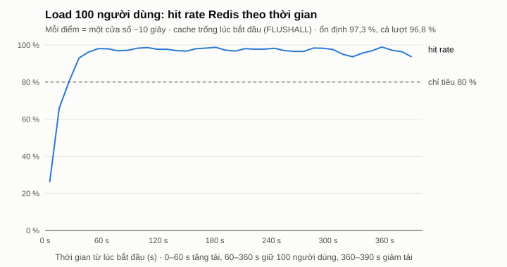
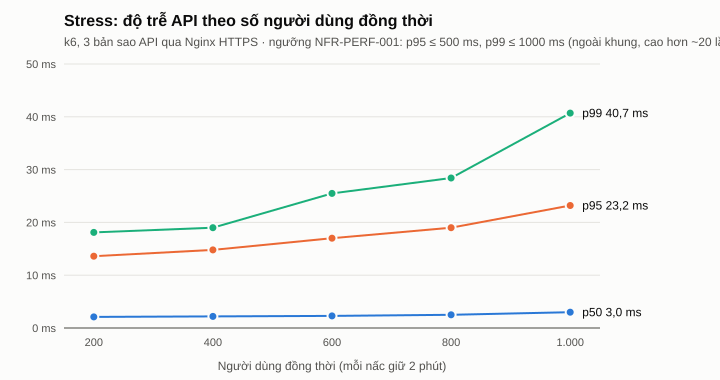
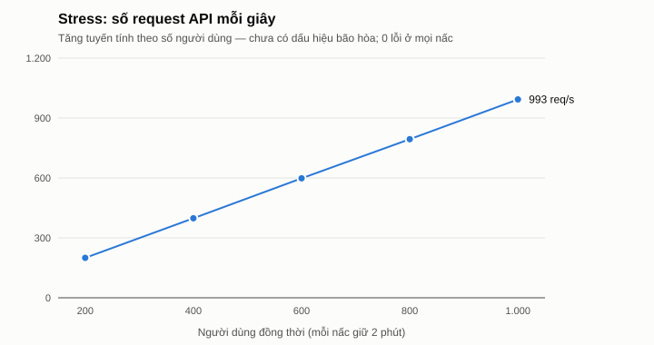

# Báo cáo load test, chịu lỗi và quét image — Buổi 8 (Dev 4)

**Phạm vi:** NFR-PERF-001 (p50 ≤ 150 ms, p95 ≤ 500 ms, p99 ≤ 1000 ms), NFR-PERF-002 (≥ 100 người dùng đồng thời), NFR-PERF-003 (hit rate ≥ 80 %),
NFR-REL-002 (chịu lỗi khi đang có tải), CONS-010 qua nhiều bản sao, kế hoạch Buổi 8 — Dev 4 bước 8 – 9 (k6, Trivy).
**Ngày đo:** 30/10/2026, nhánh `2312755_NguyenThangThieng_buoiso8` (đã gồm Buổi 7 của cả nhóm), commit `4908d59` cho các lượt đo tải.
Kịch bản, môi trường và lệnh chạy: [`tests/load/README.md`](../tests/load/README.md). Audit cache: [`docs/cache-report.md`](cache-report.md).

## 1. Kết quả so với chỉ tiêu

| Chỉ tiêu | Mục tiêu | Đo được (load, 100 người dùng) | Kết quả |
|---|---|---|---|
| p50 | ≤ 150 ms | 2,1 ms | Đạt |
| p95 | ≤ 500 ms | 13,4 ms | Đạt |
| p99 | ≤ 1000 ms | 21,5 ms | Đạt |
| Lỗi | < 1 % | 0 / 34.403 | Đạt |
| Người dùng đồng thời | ≥ 100 | 100 (load); tới 1.000 ở stress vẫn 0 lỗi, p95 23 ms | Đạt |
| Hit rate Redis | ≥ 80 % | 97,3 % giai đoạn ổn định (96,8 % cả lượt) | Đạt |
| Tắt Redis giữa lúc tải | không lỗi, chỉ chậm hơn | 0 lỗi; đọc 21 – 33 ms khi Redis tắt | Đạt (sau khi sửa — §5) |
| Tắt MinIO giữa lúc tải | công thức vẫn phục vụ, tải ảnh 503 | đúng như vậy | Đạt |
| Lỗ hổng Critical trong image chạy production | 0 | 0 ở image của dự án; 2 image nền còn lỗi chưa có bản vá | Ghi nhận rủi ro — §7 |

Các con số là **thời gian phản hồi API đo từ k6 qua Nginx HTTPS**, không phải thời gian tải trang HTML (SSR của Next.js không nằm trong kịch bản).

## 2. Môi trường đo

| Hạng mục | Giá trị |
|---|---|
| Stack | `docker-compose.prod.yml` + `docker-compose.loadtest.yml` (project `culinaryblog`): Nginx HTTPS, **3 bản sao `api`**, `hangfire`, PostgreSQL 16, Redis 7.4, MinIO |
| Khác production | hạn mức rate limit được nâng ở Nginx và API (k6 chạy từ một IP — giữ hạn mức thật thì từ giây thứ hai gần như mọi request là 429) |
| Máy | Windows 11, Docker Desktop 29.4.1, VM Docker 12 CPU / 7,6 GB RAM; **k6 2.3.0 chạy cùng máy** trong mạng Docker |
| Dữ liệu | dữ liệu mẫu CR-2026-03: 20 danh mục, 105 công thức (89 đã xuất bản), 5 Author; bản nháp do k6 tạo được xóa bằng `tests/load/cleanup.sql` sau mỗi lượt |
| Hỗn hợp truy cập | 70 % đọc (Guest), 20 % tìm kiếm (30 % kèm bộ lọc MT-66), 10 % ghi (Author tạo/sửa bản nháp có nguyên liệu + bước) — `tests/load/lib/traffic.js` |

## 3. Load — 100 người dùng đồng thời

Tăng 1 phút → giữ 100 người dùng 5 phút → giảm 30 giây. Redis được `FLUSHALL` + `CONFIG RESETSTAT` trước lượt (cache lạnh lúc bắt đầu).

| Giai đoạn | Request | req/s | p50 (ms) | p95 (ms) | p99 (ms) | max (ms) | Lỗi |
|---|---|---|---|---|---|---|---|
| Tăng tải 0 → 100 (1 phút) | 2.952 | 49 | 2,2 | 13,0 | 15,7 | 25 | 0 |
| Giữ 100 người dùng (5 phút) | 29.891 | 100 | 2,1 | 13,4 | 22,5 | 257 | 0 |
| Giảm tải (30 giây) | 1.559 | 52 | 2,2 | 13,0 | 16,4 | 23 | 0 |
| **Cả lượt** | **34.403** | **88** | **2,1** | **13,4** | **21,5** | **257** | **0** |

| Loại request | p50 (ms) | p95 (ms) | p99 (ms) | max (ms) |
|---|---|---|---|---|
| Đọc (chi tiết, danh sách, danh mục) | 2,0 | 3,0 | 6,2 | 22 |
| Tìm kiếm (FTS + bộ lọc) | 2,2 | 6,8 | 8,5 | 22 |
| Ghi (`POST`/`PUT` bản nháp có mảng nguyên liệu + bước) | 13,4 | 25,5 | 29,4 | 257 |

**Hit rate Redis** (`keyspace_hits / (hits + misses)`, lấy mẫu `redis-cli INFO stats` mỗi ~10 giây): cả lượt **96,75 %** (30.012 / 31.019);
giai đoạn ổn định (giây 90 → hết giai đoạn giữ tải) **97,27 %** (22.655 / 23.290) — khớp lượt C của `docs/cache-report.md` (97,3 %) sau CR-2026-06.

Cuối lượt, mỗi bản sao `api` dùng ~170 MiB RAM, PostgreSQL ~169 MiB, Redis 7 MiB.

## 4. Stress — tìm ngưỡng gãy

5 nấc 200 → 400 → 600 → 800 → 1.000 người dùng, mỗi nấc tăng 1 phút rồi giữ 2 phút; "gãy" = nấc đầu tiên p95 > 500 ms hoặc lỗi > 1 %.
Bảng lấy riêng cửa sổ **giữ 2 phút** của mỗi nấc.

| Nấc | Request | req/s | p50 (ms) | p95 (ms) | p99 (ms) | max (ms) | Lỗi |
|---|---|---|---|---|---|---|---|
| 200 người dùng | 23.944 | 200 | 2,1 | 13,6 | 18,1 | 61 | 0 |
| 400 người dùng | 47.778 | 398 | 2,2 | 14,8 | 19,0 | 52 | 0 |
| 600 người dùng | 71.712 | 598 | 2,3 | 17,0 | 25,5 | 309 | 0 |
| 800 người dùng | 95.332 | 794 | 2,5 | 19,0 | 28,4 | 108 | 0 |
| 1.000 người dùng | 119.207 | 993 | 3,0 | 23,2 | 40,7 | 166 | 0 |
| **Cả lượt (19 phút)** | **536.622** | **558** | **2,5** | **20,2** | **45,2** | **4.015** | **0** |

**Kết luận:** **không tìm thấy ngưỡng gãy** trong khả năng của máy phát tải. Throughput tăng tuyến tính (~1 req/s mỗi người dùng), p95 chỉ tăng
13,6 → 23,2 ms. Trần 1.000 người dùng là giới hạn của máy đo chứ không phải của hệ thống: k6 chạy cùng máy, lượt thử 2.000 người dùng ngày 21/10/2026
làm máy cạn RAM ở nấc 500 và tiến trình đo bị dừng (`tests/load/stress.js`).

**Một đợt chậm ngắn:** cả 760 request trên 500 ms của lượt (0,14 %) rơi vào **một cửa sổ 10 giây** — giây 720 – 730, đúng lúc bắt đầu tăng từ 800 lên
1.000 người dùng; chậm nhất 4,0 s, tất cả vẫn thành công. Ngoài cửa sổ đó không có request nào trên 500 ms. Chưa xác định được nguyên nhân (máy phát tải
và hệ thống dùng chung CPU nên không tách được phía nào dừng); ghi lại để đo lại trên máy phát tải riêng.

**Đối chiếu trước khi sửa pool kết nối (28/10/2026, cùng kịch bản tới 1.000 người dùng):** 452.053 request, **277 lỗi**, p95 117 ms, p99 6,0 s, max 59 s —
PostgreSQL từ chối kết nối ("too many clients") vì 3 bản sao `api` + `hangfire` mỗi tiến trình mở tối đa 100 kết nối, vượt `max_connections = 100`.
Đã sửa: pool tối đa 25 mỗi tiến trình (`DB_MAX_POOL_SIZE`), PostgreSQL production `max_connections = 200` (CHANGELOG, mục Fixed).

## 5. Chịu lỗi khi đang có tải (NFR-REL-002)

Lượt `load.js` (100 người dùng) chạy nền; ở giây ~150 dừng container `redis` 60 giây rồi bật lại; ở giây ~270 dừng `minio` 45 giây rồi bật lại.
Cùng lúc gọi thử bằng `curl` qua Nginx.

| Lượt | Request / lỗi | p95 | p99 | Đọc khi Redis tắt | Ghi (p95 cả lượt) |
|---|---|---|---|---|---|
| Trước khi sửa (code `7bae988`) | 27.968 / 0 | 24 ms | **5,73 s** | **5,6 – 6,0 s** mỗi request | — |
| Sửa lần 1: ngắt mạch GET/SET | — / 0 | 14 ms | 27 ms | 15 – 22 ms | **4,19 s** |
| Sửa lần 2: REMOVE bỏ qua khi mất kết nối (`4908d59`) | 34.347 / 0 | 14 ms | 24 ms | 21 – 33 ms | 27 ms |

**Lỗi tìm ra:** khi Redis tắt, hệ thống vẫn trả đúng dữ liệu từ PostgreSQL (không exception), nhưng mỗi lệnh tới Redis chờ hết `asyncTimeout` 2 giây
rồi mới thành cache-miss; một request đọc gọi GET rồi SET nên mất ~5,6 giây. Đúng chữ "chỉ chậm hơn" nhưng chậm gấp ~2.000 lần.
**Sửa** (`RedisCacheService`): GET/SET bỏ qua Redis ngay khi multiplexer báo mất kết nối và trong 10 giây sau một lần lỗi; lệnh xóa cache chỉ bỏ qua
khi đang mất kết nối (khi đó chờ cũng không xóa được gì) — không bao giờ bị ngắt theo thời gian, vì bỏ một lệnh xóa lúc Redis vừa hồi phục sẽ để dữ
liệu cũ sống tới hết TTL. Kiểm thử: `ObservabilityInfrastructureTests.RedisUnreachable_GetSetAndRemoveReturnImmediately`,
`AfterAFailure_GetAndSetSkipRedisForTenSeconds_RemoveIsNeverSkipped` (bỏ ngắt mạch: 5 lượt GET/SET mất 55 giây, hai test đỏ).

| Thời điểm (lượt sau khi sửa) | Quan sát |
|---|---|
| Trước sự cố | `POST /files/upload` → 201 |
| Redis tắt | `GET /recipes/{slug}` 200 trong 21 ms, `GET /categories` 200 trong 33 ms; `/health/ready` 503 (đúng thiết kế — 17 phản hồi 503 trong log đều là `/health/ready`) |
| MinIO tắt | `POST /files/upload` → **503**; `GET /recipes/{slug}` 200 (13 ms), `GET /recipes` 200 (13 ms) |
| Sau khi bật lại MinIO | `POST /files/upload` → 201 |

**Giới hạn đã biết:** Redis lưu dữ liệu xuống đĩa khi dừng, nên các khóa cache cũ còn sau khi khởi động lại; thay đổi dữ liệu xảy ra **trong lúc** Redis
tắt không xóa được các khóa đó → dữ liệu cũ tối đa bằng TTL của khóa (chi tiết công thức 5 phút, danh sách 2 phút, danh mục 30 phút). Hành vi này có từ
trước Buổi 8, không do ngắt mạch gây ra.

## 6. CorrelationId qua 3 bản sao API

30 request `GET /api/v1/categories` qua Nginx với `X-Correlation-ID` khác nhau: cả **30/30** mã xuất hiện trong log, phân bố **7 / 8 / 15** trên
`api-1` / `api-2` / `api-3` — Nginx (resolver động, MT-50) luân phiên giữa các bản sao và tra một mã trong log ra đúng container đã xử lý.
Mã hợp lệ được trả lại nguyên trong header phản hồi; mã không hợp lệ (dài hơn 64 ký tự, có `<`) bị thay bằng UUID mới.

## 7. Quét image bằng Trivy (kế hoạch: không chấp nhận lỗ hổng Critical)

Trivy 0.76.1, `--scanners vuln`, 30/10/2026. Sau khi vá (`105b9e5`):

| Image | Dùng ở | Critical | High | Ghi chú |
|---|---|---|---|---|
| `culinaryblog-api` (api, hangfire, migrate) | mọi môi trường | 0 | 4 | 4 High ở SixLabors.ImageSharp 3.1.12 (vá ở 3.2.0) — xem dưới |
| `culinaryblog-web` | mọi môi trường | **2 → 0** | 17 → 3 | `next` 15.5.25 → 15.5.28 (thực thi mã từ xa qua Image Optimization API với ảnh SVG); gỡ npm khỏi image chạy (`tar`) |
| `culinaryblog-nginx` | mọi môi trường | **1 → 0** | 14 → 7 | `nginx:1.31.6-alpine` + `brotli-libs` 1.2.1-r0 (`nginx/image/Dockerfile`) |
| `redis:7.4.11-alpine` | mọi môi trường | 0 | 2 | |
| `postgres:16.15-alpine` | mọi môi trường | 1 | 25 | Go stdlib CVE-2025-68121 trong `gosu` — chỉ chạy một lần lúc container khởi động để hạ quyền, không nhận dữ liệu mạng; chưa có bản 16.x mới hơn |
| `quay.io/minio/minio:RELEASE.2025-09-07T16-13-09Z` | mọi môi trường | 9 | 127 | 2 lỗi của chính MinIO chưa có bản vá; MinIO không còn phát hành image Docker mới. Cổng 9000/9001 đóng ở production, chỉ API và Nginx `/media/` (chỉ đọc) tới được |
| `datalust/seq:2026.1.17114` | dev | 25 | 556 | không có trong `docker-compose.prod.yml` |
| `mailhog/mailhog:v1.0.1` | dev, E2E | 109 | 1.481 | dự án đã ngừng phát triển (2020); không có trong production |

**Rủi ro được chấp nhận** (trưởng nhóm duyệt 30/10/2026): PostgreSQL (`gosu`) và MinIO — chưa có bản vá, đường khai thác không mở ra ngoài; Seq và
MailHog — chỉ chạy ở máy phát triển/E2E. **Việc tiếp theo:** quét lại khi có `postgres:16.x` mới; cân nhắc thay MinIO bằng một bản build còn được bảo trì
(phải qua Change Request vì SRS chỉ định MinIO); ImageSharp 3.2.0 cần kiểm tra điều khoản license trước khi nâng (CONG_NGHE_VA_PHIEN_BAN.md §6.2).
